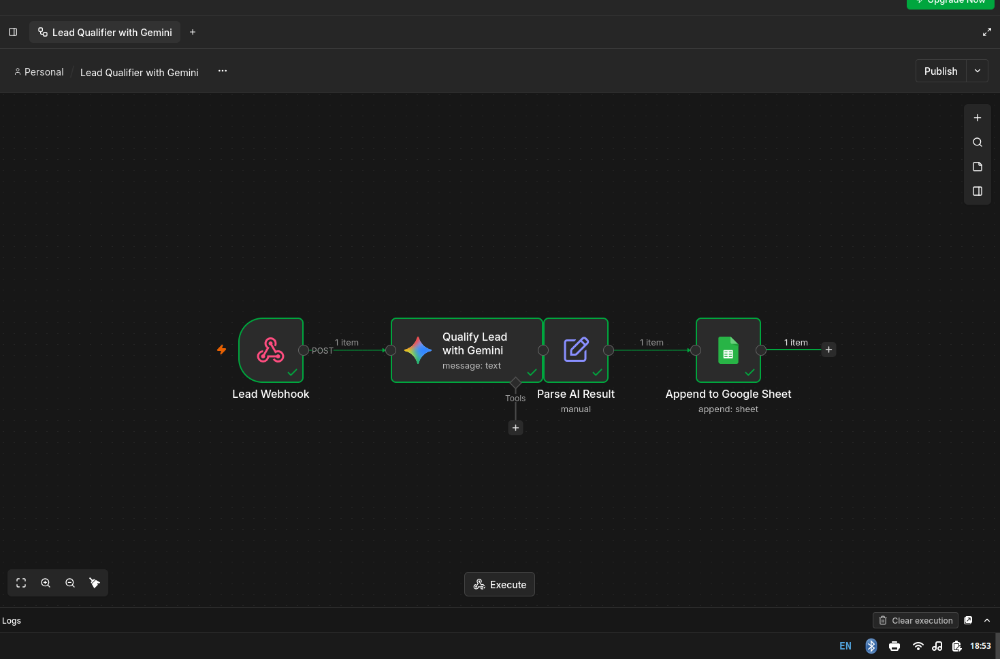
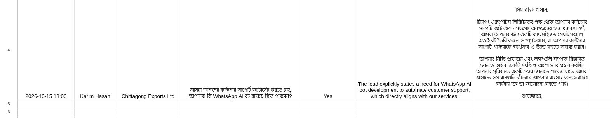

# 🤖 AI Lead Qualification Agent

An automated n8n workflow that uses Google Gemini Flash to instantly qualify inbound leads, generate personalized responses, and log the data into Google Sheets.

## 🛠️ Tools Used
- **n8n** (Workflow Automation)
- **Google Gemini 1.5 Flash** (Fast, cost-effective LLM for structured JSON)
- **Google Sheets** (Data logging)

## ⚙️ How It Works
1. A `POST` request hits the n8n Webhook with `name`, `company`, and `message`.
2. Google Gemini evaluates if the lead matches the Ideal Customer Profile (ICP).
3. Gemini returns structured JSON: `Qualified` (Yes/No), `Reason`, and `AI_Reply`.
4. The data is parsed and automatically appended to a Google Sheet.

## 📸 Visual Proof
### 1. n8n Workflow Canvas

### 2. Google Sheets Output

---
*Built for the AI Automation Engineer role application at Growbig100.*
